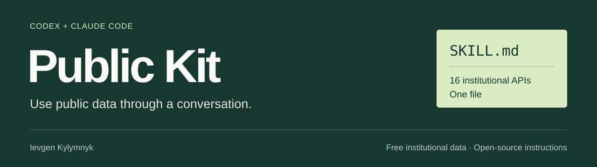

**One SKILL.md for working with public data, evidence and choices.**

By [Ievgen Kylymnyk](https://github.com/klmnki) · Codex + Claude Code · MIT · Preview release

[**Get SKILL.md ↓**](https://raw.githubusercontent.com/klmnki/public-kit/main/SKILL.md) · [Read the skill](SKILL.md) · [Try the example](https://klmnki.github.io/public-kit/#example) · [Browse sources](https://klmnki.github.io/public-kit/#sources)

Public Kit helps a coding agent turn a public-interest question into an analysis, a decision brief, an inspectable model or a repeatable workflow. It grew from my [Public API Marketplace](https://genai-builders-api-marketplace.klmnki.chatgpt.site/) and experiments with AI beyond text.

## The whole skill is one file

[SKILL.md](SKILL.md) contains the method, a 27-source directory, output templates, a worked example and its licence. You can read it, change it and use it without this website or any bundled scripts.

| When you want to… | The skill helps you… |
| --- | --- |
| Find evidence | Match sources to the actual question; inspect access, coverage and definitions. |
| Understand a pattern | Preserve missing values, align denominators and distinguish correlation from cause. |
| Compare choices | Make criteria, constraints and value judgments explicit. |
| Explore a scenario | Show assumptions, test sensitivity and avoid presenting scores as forecasts. |
| Repeat useful work | Record transformations, refresh steps, validation and failure handling. |

## Install

Save **[SKILL.md](SKILL.md)** in one of these project locations:

```text
Codex        .agents/skills/public-kit/SKILL.md
Claude Code  .claude/skills/public-kit/SKILL.md
```

Then invoke `$public-kit` in Codex or `/public-kit` in Claude Code. [Personal installation and client details →](docs/INSTALL.md)

Try: “Compare these policy options. Show the evidence, the assumptions and what would change the conclusion.”

## Inspect an example

[The live example](https://klmnki.github.io/public-kit/#example) compares three synthetic heat-response options under a budget. Changing priorities changes the ordering. Every input and equation is visible; export the assumptions and results as JSON.

The numbers are invented for teaching. They do not estimate health effects, represent a real city or establish a funding recommendation.

## Sources and limits

The directory includes World Bank, UNDP GeoHub, SDG statistics, Open-Meteo, Eurostat, HDX, OpenAlex and other providers. Its 27 entries reflect the public Marketplace metadata reviewed on **10 October 2026**. All endpoints and terms have **not** been independently retested for this release. Check current documentation before use; provider data keeps its own licence.

This is a preview. Structural checks and the example's calculations are tested. Consistent analytical performance across Codex and Claude has not been established through a client evaluation study. Models still need review; installing the skill does not add tools or authorize external actions.

## Build the website locally

Only the optional website requires Node.js 22+. There are no npm dependencies.

```sh
npm test
npm run build
npm run preview
```

Open `http://127.0.0.1:4188`. The build copies the root `SKILL.md` byte-for-byte to the site and generates its SHA-256 checksum. GitHub Pages deploys from the checked workflow.

## Where the idea comes from

Inspired by [sgarcese's Civic Analytics Agent Workflow](https://github.com/sgarcese/Civic-Analytics-Agent-Workflow-Claude-Skill), with methodological references to [Harvard PDIA](https://bsc.hks.harvard.edu/tools/toolkit/), [J-PAL's generalizability framework](https://www.povertyactionlab.org/blog/5-24-17/practical-framework-evidence-informed-policy-addressing-generalizability-puzzle) and [Johns Hopkins public innovation practice](https://publicinnovation.jhu.edu/resources/the-path-playbook/). The instructions are independently written. This is a personal project with no institutional endorsement.

## Make it more useful

Share a real adaptation, report an outdated source or improve a step that failed in practice. [Contribution guide](CONTRIBUTING.md) · [Open an issue](https://github.com/klmnki/public-kit/issues)

Original code and instructions are [MIT licensed](LICENSE). Referenced materials and provider data retain their own rights. See [NOTICE](NOTICE.md).
